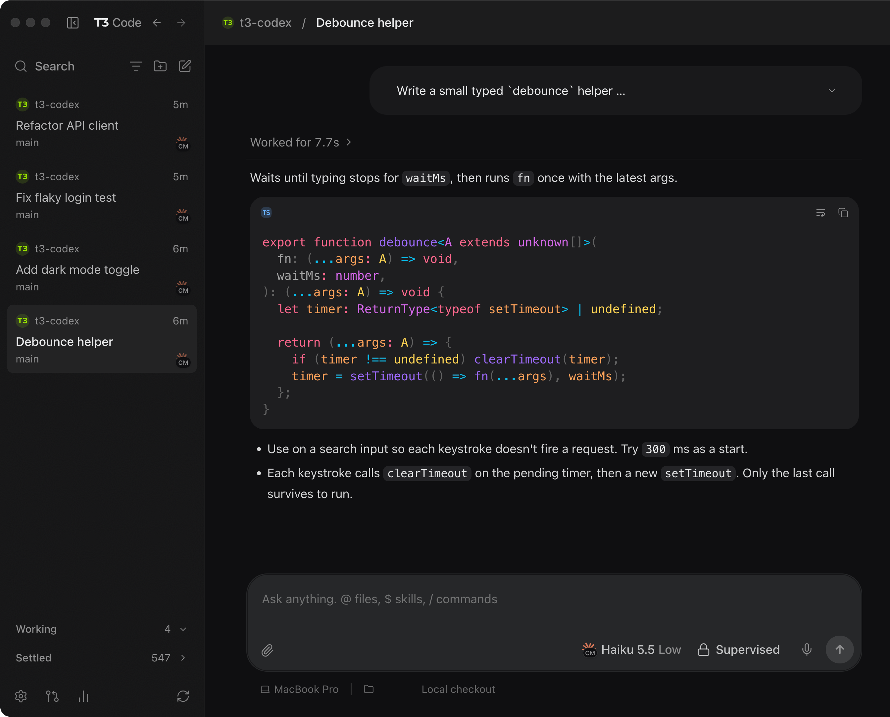

# T3 Codex

A theme that makes [T3 Code](https://t3.codes) look like the Codex app: neutral greys, a rounded composer, soft message bubbles and a quiet sidebar. Dark and light modes are both included.



## Install

You need a T3 Code build with theme support. As of November 2026 that is the Nightly build.

**Option 1: import the file**

1. Download [`themes/t3-codex.json`](themes/t3-codex.json).
2. In T3 Code, open **Settings > Appearance**.
3. Import the theme file and select **T3 Codex**.

**Option 2: ask the agent**

Paste this into any T3 Code thread:

```
Apply the T3 Codex theme from https://raw.githubusercontent.com/<owner>/t3-codex/main/themes/t3-codex.json
```

The agent reads the file and applies it with T3 Code's theme tool.

**Undo:** pick any built-in theme (T3 Chat, Grove, Ocean, Ember or Iris) in Settings > Appearance.

## What it changes

- Color roles for the canvas, sidebar, toolbar, messages, code blocks, menus and terminal, in dark and light
- System font stack and SF Mono for code
- Rounded composer card, user message bubbles, menus and dialogs
- Thinner icon strokes and slimmer scrollbars

It only uses T3 Code's public theme API (color roles plus CSS on stable selectors), so it should survive app updates. If something looks off after an update, open an issue with a screenshot.

## Make your own

The theme is one JSON file:

```json
{
  "version": 1,
  "id": "my-theme",
  "name": "My Theme",
  "appearance": "dark",
  "colors": { "canvas": "#212121", "accent": "#f9f9f9" },
  "variants": { "light": { "canvas": "#ffffff", "accent": "#0d0d0d" } },
  "css": "[data-slot=\"composer-host\"] { border-radius: 28px !important; }"
}
```

Run `node scripts/validate.mjs` to check a theme against the rules T3 Code applies on import (version, id, hex colors, CSS size, no `@import` or external `url()`).

## Credits

Inspired by [T3 Clawd](https://x.com/rohit3a/status/2121724781376786584) by [@rohit3a](https://x.com/rohit3a). Built for [T3 Code](https://t3.codes) by the T3 team.

Not affiliated with OpenAI or T3. Codex is a trademark of OpenAI.

## License

[MIT](LICENSE)
